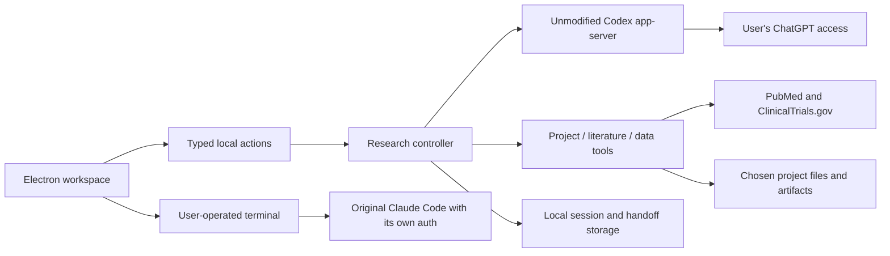

# NutritiScan Biology Workspace — local desktop prototype

A Mac research workspace with agent chat, project files, public evidence, CSV/FHIR
inspection, persistent project context and an interactive terminal. This version
uses the user's installed Codex runtime and existing ChatGPT sign-in. It does not
train or host a model, collect model credentials or fall back to a paid API key.

This is a working local prototype, not a validated medical scientist, diagnostic
device, autonomous laboratory, or complete replacement for Claude Code/Codex.

## Run on this Mac

The packaged Apple Silicon build is `release/NutritiScan.app`. Open it, choose
**Explore the sample project** or a dedicated research folder, and select
**Connect through Codex**. If Codex is already signed in with ChatGPT, the app uses
that existing managed sign-in. Otherwise Codex opens its own browser login flow.
Choose an available model and send a research task. A catalog entry is not proof
of entitlement; the provider decides access and subscription limits.

Prerequisites for development: Node.js 24+, the official Codex CLI (tested with
0.166.0), and Python 3 for the terminal. Claude Code is optional (tested launcher
version 2.1.311). No GPU or model download is needed for hosted inference.

```sh
cd desktop
npm ci
npm start
```

The terminal starts a clean user-operated zsh shell in the chosen project.
**Open Claude Code in terminal** launches the original CLI with a per-process
biology context file. It retains Claude Code's own sign-in, tools and permission
prompts. NutritiScan does not forward Claude subscription tokens into its chat.
Native Claude Code tools differ from the custom tools in the Codex chat.

## Current workflow

1. Choose one project folder. Inspect the file list or read supported text files.
2. Ask the agent to inspect data, search public literature or develop a research
   question. Streamed messages and tool activity remain visible; Stop interrupts.
3. Inspect PubMed abstracts and ClinicalTrials.gov metadata in Evidence.
   `verify_evidence` checks proposed passages against the retrieved source snapshot.
   It withholds unknown citations, missing passages and unusable papers. A passage
   match establishes text membership only, not claim entailment or scientific validity.
4. Profile a CSV/TSV or import top-level FHIR Observation measurements. Descriptive
   results include missingness and a source SHA-256. Units are not inferred and
   original files are preserved. Mixed text/numeric columns receive no numeric mean.
5. Save new artifacts and a concise handoff, continue or reopen a saved session,
   and export the transcript with sources. New artifacts never overwrite earlier work.
6. Use the control beside a project or investigation to rename or archive it.
   **Archived work** restores it. Removal is limited to archived work and requires
   native confirmation; it only removes app history, never project files or reports.
   Archived items still count toward the storage limits. Restore and export first
   if you want a copy. Codex maintains its original thread history separately.
7. **Files → Saved reports** lists artifacts in the bounded project inventory.
   Markdown reports render in the inspector; **Refresh files** rescans changes.

Useful first task with the included fictional dataset:

> Inspect this project, profile instrument-readings.csv, explain its schema and
> limitations, save a Markdown analysis record, and update the project handoff.

The sample file is synthetic software-test data. It supports no disease or
treatment conclusion. Literature searches are independent public-source requests.

## Architecture



The renderer has no Node access and cannot fetch the network. A narrow preload
bridge reaches validated main-process actions. The main process owns files,
public retrieval, persistence and the local Codex subprocess. It sends JSONL
messages over stdio, owns application tool handlers and accepts events only for
the active research thread/turn. Project data is refreshed as lower-priority user
context; it is not interpolated into developer instructions.

The local CLI keeps authentication inside Codex. The child inherits a small
environment allowlist, not API keys or application credentials. Before an inference
turn, account mode must be ChatGPT and the returned thread provider must be OpenAI.
There is no API-key login path or alternate paid provider. Shell, hooks, apps,
plugins and other unrelated features are disabled for the chat subprocess; inherited
MCP connections receive explicit disabled entries. Native write/permission approval
requests are declined. A read-only Codex sandbox supplements project-scoped host
tools; a complete model-facing tool whitelist has not been independently established.

## Data and limits

Local app state is plain JSON under macOS Application Support/NutritiScan, written
atomically with owner-only file permissions. It is not application-level encrypted.
Project files remain in their original folder; artifacts go to `artifacts/`.
Selected messages, requested file content, handoff and retrieved evidence go to the
chosen model provider during a run. Public search terms go to the enabled databases.
Use public or appropriately de-identified research data. This prototype is not a
patient-record workflow or a claim of healthcare compliance.

- Twelve projects; twenty sessions per project; bounded transcripts and 20 MB state.
- Supported previews: Markdown, text, CSV, TSV, JSON, FASTA, Python and R text.
- Up to 2 MB per input file; previews stop at 60,000 characters.
- CSV/TSV: 20,000 rows and 80 columns; malformed widths/quotes are rejected.
- FHIR: up to 1,000 resources; top-level numeric Observation values only.
- Literature: up to five PubMed and three trial records per search; abstracts and
  registry metadata only. No full-text/PDF extraction or exhaustive review.
- Five-minute agent turns and forty tool calls; retained partial work can be continued.
- File inventory is bounded. Hidden/secret paths, traversal and symbolic links are excluded.
- No live USB, serial, BLE or network instrument connection; no physical experiment
  or instrument command is performed. No automatic Python/R code execution in the
  custom chat; the native terminal remains user-operated.

## Subscription integration and distribution

This free local preview uses the installed Codex runtime. OpenAI's current
app-server documentation permits existing local/open-source clients to continue
using app-server authentication and recommends moving to Sign in with ChatGPT.
This is not a registered third-party Sign in with ChatGPT client or commercial
partner approval. Commercial/hosted integration needs the relevant provider
eligibility; the website distributes a local app, not hosted subscription inference.
See the [official app-server documentation](https://learn.chatgpt.com/docs/app-server)
and [Sign in with ChatGPT guide](https://developers.openai.com/siwc/quickstart).

Claude Code is launched unchanged. Subscription sign-in remains in Anthropic's
client; custom product/API access has separate rules. See [Anthropic's integration conditions](https://code.claude.com/docs/en/legal-and-compliance).

The `.app` is ad-hoc signed, not notarized by Apple. The website labels this as
a preview and links Apple's installation guidance. `npm run archive` produces
a versioned ZIP, SHA-256 file and the website's `lib/desktop-release.json` manifest.
Publish those exact assets before publishing a website that points to the version.
Existing web releases and unfinished pilot/pricing work are separate and preserved.

## Verification

```sh
npm test
npm run build
node scripts/smoke-desktop.mjs
# Explicit live checks consume existing subscription usage:
node scripts/smoke-agent.mjs
node scripts/smoke-agent.mjs --literature
npm run package
npm run archive
# With the web server running, or after deployment:
node scripts/smoke-download.mjs
node scripts/smoke-download.mjs --url=https://www.nutritiscan.com --verify-download
```

The initial build passed 28 unit tests and native UI checks at 800, 1000 and 1400
pixels, both themes, real PTY input, memory persistence and restart. Actual managed
ChatGPT authentication returned an eight-model catalog. Two explicit GPT-6.1 Sol
checks completed: a synthetic dataset task (inspect, profile, save artifact, handoff)
and a public literature task (five PubMed records, one matching quoted passage,
saved record and handoff). These are functional checks, not a scientific accuracy
benchmark or validation of clinical use.

The packaged, ad-hoc-signed app also passed a native chat task and restart check
with Finder's minimal PATH. This separately verified that the installed CLI and
terminal remain discoverable outside a developer shell. The packaged test uses
`node scripts/smoke-desktop.mjs --packaged --finder-env --live`; its live step uses
the existing subscription and synthetic data only.

## Next engineering milestones

1. Broader scientific evaluations with researcher corrections and retrieval-quality
   measurements; extend source-context checking beyond exact quote membership.
2. A governed Python/R analysis runner with previewed code, reproducible dependencies,
   resource limits and separate execution records. Arbitrary execution is not enabled now.
3. PDF/full-text ingestion, curated biology databases and stronger project/version recovery.
4. One actual read-only instrument adapter after obtaining its device model,
   documented transport/protocol, sample exports, units and calibration metadata.
   Validate decoding against the instrument's own output before expanding access.
5. Registered provider sign-in and a reviewed distribution/licensing plan before
   inviting other subscribers or selling hosted model access.
