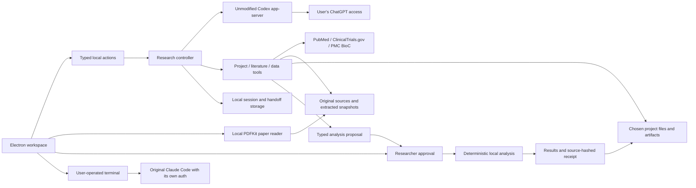

# NutritiScan Biology Workspace — Mac preview 0.4.0

A Mac research agent with project files, public evidence, CSV/FHIR inspection,
page-linked PDF/PMC reading, reviewable analyses, persistent context and an interactive terminal. The product
direction is a working environment for human-biology research, beginning with
cancer biology and treatment resistance. See the [active roadmap](../docs/RESEARCH_PRODUCT_ROADMAP.md).
This version
uses the user's installed Codex runtime and existing ChatGPT sign-in. It does not
train or host a model, collect model credentials or fall back to a paid API key.

This is a working local prototype, not a validated medical scientist, diagnostic
device, autonomous laboratory, or complete replacement for Claude Code/Codex.

## Run on this Mac

The new local Apple Silicon build is `release/v0.4.0/NutritiScan.app`. Earlier local builds are preserved. The published version and checksum are listed at
https://www.nutritiscan.com/download. Open the new app, choose
**Explore the sample project** or a dedicated research folder, and select
**Connect through Codex**. If Codex is already signed in with ChatGPT, the app uses
that existing managed sign-in. Otherwise Codex opens its own browser login flow.
Choose an available model and send a research task. A catalog entry is not proof
of entitlement; the provider decides access and subscription limits.

Prerequisites for development: Node.js 24+, the official Codex CLI (tested with
0.166.0), and Python 3 for the terminal. Claude Code is optional (tested launcher
version 2.1.311). No GPU or model download is needed for hosted inference.

```sh
cd desktop
npm ci
npm start
```

The terminal starts a clean user-operated zsh shell in the chosen project.
**Open Claude Code in terminal** launches the original CLI with a per-process
biology context file. It retains Claude Code's own sign-in, tools and permission
prompts. NutritiScan does not forward Claude subscription tokens into its chat.
Native Claude Code tools differ from the custom tools in the Codex chat.

## Current workflow

1. Choose one project folder. Inspect the file list or read supported text files.
2. Ask the agent to inspect data, search public literature or develop a research
   question. Streamed messages and tool activity remain visible; Stop interrupts.
3. Inspect PubMed abstracts and ClinicalTrials.gov metadata in Evidence.
   `verify_evidence` checks proposed passages against the retrieved source snapshot.
   It withholds unknown citations, missing passages and unusable papers. A passage
   match establishes text membership only, not claim entailment or scientific validity.
4. Profile a CSV/TSV or import top-level FHIR Observation measurements. Profiles
   include missingness and a source SHA-256. Units are not inferred; original files
   are preserved. Mixed text/numeric columns receive no numeric mean.
5. In a new investigation, ask for an analysis proposal using inspected CSV/TSV
   columns. **Analysis** shows the exact recipe and full-input fingerprint. Review
   the missing-value rules, then **Approve & run analysis** or reject it. Proposing
   performs no computation. Profiles can also be proposed directly in the panel
   without connecting a model.
6. Inspect grouped summaries/charts or Pearson correlations, including missingness
   and pair counts. Open the JSON receipt, then ask the agent to inspect the completed
   result and save an interpretation. A changed source invalidates an old approval.
7. Save new artifacts and a concise handoff, continue or reopen a saved session,
   and export the transcript with sources. New artifacts never overwrite earlier work.
8. Use the control beside a project or investigation to rename or archive it.
   **Archived work** restores it. Removal is limited to archived work and requires
   native confirmation; it only removes app history, never project files or reports.
   Archived items still count toward the storage limits. Restore and export first
   if you want a copy. Codex maintains its original thread history separately.
9. **Files → Saved reports** lists artifacts in the bounded project inventory.
   Markdown reports render in the inspector; **Refresh files** rescans changes.

Useful first task with the included fictional dataset:

> Inspect synthetic-cohort.csv. Propose grouped summaries of signal_au by cohort
> and a correlation with readout_au. Use blank cells as the only missing values.
> Wait for me to review and approve the plan in Analysis.

After approval, ask the agent to inspect the completed result, explain its actual
values and exclusions, save a Markdown report and update the handoff. The expected
fictional means are 5 and 12; seven complete pairs have Pearson r = 1 with one
missing value. Start a new investigation to obtain tools added in this version;
resumed Codex threads retain their original tool definitions.

The sample file is synthetic software-test data. It supports no disease or
treatment conclusion. Literature searches are independent public-source requests.

## Paper reading in 0.4.0

Open **Papers** and import a PDF from the native file picker, choose a PDF already
inside the project, or enter an exact PMC identifier and **Fetch open full text**.
Importing, searching and previewing do not require a model connection.

Local PDFs retain a new original copy and a text snapshot under `papers/`.
The reader shows the original physical page beside extracted text, with page
navigation, literal search, highlighting and Fit/100%/150% zoom. Blank or image-only
pages remain in the index as **no text**. There is no OCR, table reconstruction,
equation interpretation or figure analysis.

PMC imports use the official BioC open-access service and accept clearly recorded
CC BY or CC0 licences. Original BioC bytes, article identifier, source URL, licence,
attribution and the extracted passages are retained. Other/unknown licences and
unavailable records produce an explicit failure. PMC passage locators are not PDF
or journal page numbers. This is one-article retrieval by ID, not a full-text
search engine or an exhaustive collection. No publisher-page scraping is used.
See [PMC reuse and services](https://pmc.ncbi.nlm.nih.gov/tools/openftlist/) and
[the BioC API](https://www.ncbi.nlm.nih.gov/research/bionlp/RESTful/pmcoa.cgi/).

Ask a new investigation:

> Import sample-paper.pdf, inspect its section index, read the results page and
> verify a quotation against its exact page and fingerprint. Save a report with
> clickable passage citations, source identity and extraction limits. These are
> fictional software-test values and support no biological conclusion.

The agent has project-scoped import/list/inspect/read/search/verify tools. It cannot
invoke the native file picker or fetch an arbitrary URL. The original and
extracted snapshots are rehashed before section reads and quotation checks.
Changed or absent originals, changed snapshots, wrong sections and invented
quotations are withheld. Saved checks record text membership at a particular time,
not scientific approval, authorship verification or current retraction status.

Click an inline `nutritiscan://paper/<UUID>/<section>` citation in the chat or a
saved report to open its source. Recorded checks in **Papers** also open and
highlight their quoted passage. These links resolve inside the active project;
reports should include the original URL/PMC ID or PDF filename/page as well.
Transcript export includes references and recorded checks, not the source binaries.
Retain the project folder and app state; portable project bundles remain roadmap work.

Extraction uses a bundled, short-lived Apple PDFKit helper with a 20-second host
deadline and bounded input/output. It uses no network or document actions, and
inherits no model credentials. It is a PDF parser, not a general-purpose execution
sandbox. Development builds require the macOS Swift command-line toolchain; users
of the packaged app do not need Swift installed.

Paper limits: thirty per project; PDF 20 MB/80 pages; PMC response 2 MB/500 passages;
40,000 characters per section and 400,000 per document. Excessive input is rejected
rather than silently truncated. Literal search returns the first twelve matching
sections with an explicit limited flag. Figures/supplements, retraction monitoring,
semantic search and broader licence support remain future work.

## Architecture



The renderer has no Node access and cannot fetch the network. A narrow preload
bridge reaches validated main-process actions. The main process owns files,
public retrieval, persistence and the local Codex subprocess. It sends JSONL
messages over stdio, owns application tool handlers and accepts events only for
the active research thread/turn. Project data is refreshed as lower-priority user
context; it is not interpolated into developer instructions.

The local CLI keeps authentication inside Codex. The child inherits a small
environment allowlist, not API keys or application credentials. Before an inference
turn, account mode must be ChatGPT and the returned thread provider must be OpenAI.
There is no API-key login path or alternate paid provider. Shell, hooks, apps,
plugins and other unrelated features are disabled for the chat subprocess; inherited
MCP connections receive explicit disabled entries. Native write/permission approval
requests are declined. A read-only Codex sandbox supplements project-scoped host
tools; a complete model-facing tool whitelist has not been independently established.

Analysis uses a separate declarative engine, `nutritiscan-descriptive-v1`. The
agent can propose and inspect plans, but execution is only exposed to the native
Analysis panel. Supported operations are profile, grouped count/min/max/mean/sample
SD and Pearson correlation with at least three complete pairs. Blank cells are
missing by default; any additional codes must be explicitly declared. Unknown
nonnumeric values, invalid columns and excessive groups fail instead of silently
changing the dataset. Duplicate rows are counted and retained.

Each approved result saves a new JSON receipt with the complete-file fingerprint,
byte count, engine version, recipe, approval/completion times, results and exclusions.
Receipts do not copy the original source data, preview rows or a runtime environment.
Reproduction requires the original file with the same digest and a compatible
engine; **Propose another run** creates a new plan requiring review. This milestone
does not add significance testing, causal inference, differential expression,
survival models or autonomous experiment execution.
Receipts are non-overwriting local files, not signed audit attestations.

## Data and limits

Local app state is plain JSON under macOS Application Support/NutritiScan, written
atomically with owner-only file permissions. It is not application-level encrypted.
Project files remain in their original folder; artifacts go to `artifacts/`.
Selected messages, requested file content, handoff and retrieved evidence go to the
chosen model provider during a run. Public search terms go to the enabled databases.
Use public or appropriately de-identified research data. This prototype is not a
patient-record workflow or a claim of healthcare compliance.

- Twelve projects; twenty sessions per project; bounded transcripts and 20 MB state.
- Supported previews: Markdown, text, CSV, TSV, JSON, FASTA, Python and R text.
- Up to 2 MB per input file; previews stop at 60,000 characters.
- CSV/TSV: 20,000 rows and 80 columns; malformed widths/quotes are rejected.
- Twelve analysis records per investigation; six operations per plan; forty
  groups per summary; no numeric coercion, imputation or automatic deduplication.
- FHIR: up to 1,000 resources; top-level numeric Observation values only.
- Literature: up to five PubMed and three trial records per search; abstracts and
  registry metadata through search. Permitted PMC full text is retrieved separately by exact ID; no exhaustive review.
- GDC/TCGA, GEO and Open Targets are curated reference links, not data connectors.
- Five-minute agent turns and forty tool calls; retained partial work can be continued.
- File inventory is bounded. Hidden/secret paths, traversal and symbolic links are excluded.
- No live USB, serial, BLE or network instrument connection; no physical experiment
  or instrument command is performed. No automatic Python/R code execution in the
  custom chat; the native terminal remains user-operated.

## Subscription integration and distribution

This free local preview uses the installed Codex runtime. OpenAI's current
app-server documentation permits existing local/open-source clients to continue
using app-server authentication and recommends moving to Sign in with ChatGPT.
This is not a registered third-party Sign in with ChatGPT client or commercial
partner approval. Commercial/hosted integration needs the relevant provider
eligibility; the website distributes a local app, not hosted subscription inference.
See the [official app-server documentation](https://learn.chatgpt.com/docs/app-server)
and [Sign in with ChatGPT guide](https://developers.openai.com/siwc/quickstart).

Claude Code is launched unchanged. Subscription sign-in remains in Anthropic's
client; custom product/API access has separate rules. See [Anthropic's integration conditions](https://code.claude.com/docs/en/legal-and-compliance).

The `.app` is ad-hoc signed, not notarized by Apple. The website labels this as
a preview and links Apple's installation guidance. A version-specific output
directory preserves earlier apps. `archive --local` produces a ZIP, SHA-256 file
and `desktop-release.local.json` beside the app without updating the website.
Without `--local`, archive updates the website's `lib/desktop-release.json`;
use that publication step only when publishing the exact archive and verifying
its download URL. Publication uses the versioned GitHub release and the download manifest; local packaging alone does not publish it.
Existing web releases and unfinished pilot/pricing work are separate and preserved.

## Verification

```sh
npm test
npm run build
node scripts/smoke-desktop.mjs
# Explicit live checks consume existing subscription usage:
node scripts/smoke-agent.mjs
node scripts/smoke-agent.mjs --literature
node scripts/smoke-paper-agent.mjs
node scripts/smoke-pmc.mjs
npm run test:agent-analysis
node scripts/package.mjs --output-dir=release/v0.4.0
node scripts/smoke-desktop.mjs --app=release/v0.4.0/NutritiScan.app --finder-env
node scripts/smoke-papers.mjs --app=release/v0.4.0/NutritiScan.app --finder-env --pmc=PMC1790863
node scripts/archive.mjs --app=release/v0.4.0/NutritiScan.app --local
# With the web server running, or after deployment:
node scripts/smoke-download.mjs
node scripts/smoke-download.mjs --url=https://www.nutritiscan.com --verify-download
```

Version 0.4.0 passes 58 unit/contract tests and a production build. Root lint
passes with the one pre-existing unused-import warning in
`scripts/workspace-migrate.mjs`.

A real managed GPT-6.1 Sol check imported the fictional PDF, inspected its index,
read p2, verified exact quotations and saved a report with clickable passage links
and a project handoff. It used the existing Codex sign-in, with no paid API fallback.
The retained report and checks are under `test-results/live-paper-agent/`.

Native paper-reader checks pass the file picker, original-page display and zoom,
literal search/highlight, withheld and matching quotations, blank-page handling,
inline report citations, transcript export, both themes, the 800-pixel reader and
restart. Live PMC retrieval also passes source/licence checks and passage reading:
the official example PMC1790863 returns 121 passages, 120 with text. A separate
connector check verifies original/extraction hashes, quotation membership and
restart. One live attempt received HTTP 429; no result was invented, prior papers
were preserved, and the added cooldown respects Retry-After without automatic
retry loops.

The final package and archive verification receipt is stored under
`release/v0.4.0/`. Earlier checks cover the analysis approval/result loop, real PTY,
archive/restore, saved reports, persistence and managed model discovery. Functional
checks do not establish scientific accuracy, cancer findings or clinical validity.

## Next engineering milestones

1. Broader scientific evaluations with researcher corrections and retrieval-quality
   measurements; extend source-context checking beyond exact quote membership.
2. Broader full-text coverage, stronger evidence/context evaluation and retraction/update monitoring.
3. A governed Python/R runner and one real cancer cohort workflow, with reference
   analyst outputs, pinned environments, resource limits and independent validation.
4. One actual read-only instrument adapter after obtaining its device model,
   documented transport/protocol, sample exports, units and calibration metadata.
   Validate decoding against the instrument's own output before expanding access.
5. Registered provider sign-in and a reviewed distribution/licensing plan before
   inviting other subscribers or selling hosted model access.
